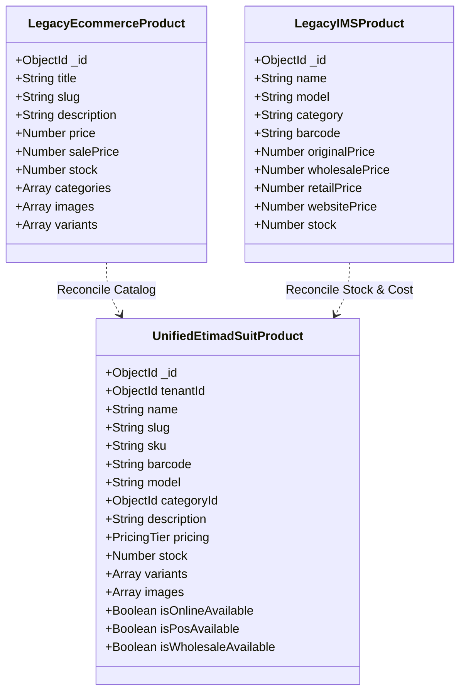
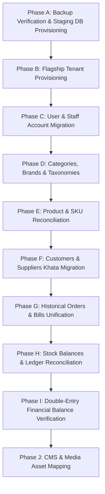

# Database Architecture & Data Migration Plan

> **Status:** APPROVED MIGRATION BLUEPRINT  
> **Source Databases:** Etimad Mart E-Commerce DB & Etimad Mart IMS DB  
> **Target Database:** Etimad Suit Multi-Tenant Authoritative Database  
> **Target Engine:** MongoDB 7+ with Mongoose 8.x  

---

## 1. Schema Conflict Analysis & Reconciliation

An audit of both repositories reveals that they previously operated with conflicting schemas for core business entities:



### 1.1 Product Schema Collision Resolution
- **Title vs Name**: Standardized as `name` (indexed for search) with `slug` for storefront URLs.
- **Category (Array of ObjectIds vs String)**: Normalized to `categoryId` (ObjectId reference to tenant-scoped `Category`), with optional secondary categories.
- **Price Fragmentation**: Unified into a structured pricing subdocument:
  - `costPrice` (from IMS `originalPrice` / purchase landed cost)
  - `retailPrice` (from IMS `retailPrice`)
  - `websitePrice` (from Ecommerce `salePrice` or `price`)
  - `wholesalePrice` (from IMS `wholesalePrice`)
- **Stock Reconciliation**: When reconciling existing products between the two databases:
  1. Products are matched by normalized Model number or Barcode.
  2. If matched, the **IMS stock quantity is authoritative** because IMS actively tracked physical stock movements and dispatches.
  3. The product is enriched with the rich media (Cloudinary galleries, descriptions) from the E-Commerce database.

---

## 2. Target Multi-Tenant Schema Specifications

### 2.1 Tenant Entity (`Tenant`)
```javascript
const tenantSchema = new mongoose.Schema({
  name: { type: String, required: true, trim: true },
  slug: { type: String, required: true, unique: true, lowercase: true, trim: true },
  subdomain: { type: String, required: true, unique: true, lowercase: true, trim: true },
  customDomains: [{
    domain: { type: String, lowercase: true, trim: true },
    isVerified: { type: Boolean, default: false },
    verificationToken: String,
    verifiedAt: Date,
    isPrimary: { type: Boolean, default: false }
  }],
  status: { type: String, enum: ['active', 'suspended', 'trial', 'cancelled'], default: 'trial' },
  ownerId: { type: mongoose.Schema.Types.ObjectId, ref: 'User', required: true },
  planId: { type: mongoose.Schema.Types.ObjectId, ref: 'Plan', required: true },
  settings: {
    currency: { type: String, default: 'PKR' },
    currencySymbol: { type: String, default: 'Rs.' },
    timezone: { type: String, default: 'Asia/Karachi' },
    logoUrl: String,
    faviconUrl: String,
    primaryColor: { type: String, default: '#0284c7' },
    secondaryColor: { type: String, default: '#0f172a' }
  }
}, { timestamps: true });

tenantSchema.index({ 'customDomains.domain': 1 }, { unique: true, sparse: true });
```

### 2.2 Canonical Product Entity (`Product`)
```javascript
const productSchema = new mongoose.Schema({
  tenantId: { type: mongoose.Schema.Types.ObjectId, ref: 'Tenant', required: true, index: true },
  name: { type: String, required: true, trim: true },
  slug: { type: String, required: true, trim: true },
  sku: { type: String, trim: true },
  barcode: { type: String, trim: true },
  model: { type: String, trim: true },
  categoryId: { type: mongoose.Schema.Types.ObjectId, ref: 'Category', required: true },
  subCategoryId: { type: mongoose.Schema.Types.ObjectId, ref: 'SubCategory' },
  brandId: { type: mongoose.Schema.Types.ObjectId, ref: 'Brand' },
  description: { type: String, default: '' },
  longDescription: { type: String, default: '' },
  
  // Authoritative Multi-Channel Pricing
  pricing: {
    costPrice: { type: Number, required: true, min: 0, default: 0 },
    retailPrice: { type: Number, required: true, min: 0 },
    websitePrice: { type: Number, required: true, min: 0 },
    wholesalePrice: { type: Number, required: true, min: 0 },
    minWholesaleQty: { type: Number, default: 6, min: 1 }
  },
  
  // Authoritative Physical Stock Balance
  stock: { type: Number, required: true, min: 0, default: 0 },
  lowStockThreshold: { type: Number, default: 5 },
  
  // Channel Availability Controls
  isOnlineAvailable: { type: Boolean, default: true },
  isPosAvailable: { type: Boolean, default: true },
  isWholesaleAvailable: { type: Boolean, default: true },
  
  images: [{
    url: { type: String, required: true },
    public_id: String,
    alt: String,
    isPrimary: { type: Boolean, default: false }
  }],
  variants: [{
    name: String,
    sku: String,
    barcode: String,
    priceModifier: Number,
    stock: Number
  }]
}, { timestamps: true });

// Compound Tenant-Scoped Unique Indexes
productSchema.index({ tenantId: 1, slug: 1 }, { unique: true });
productSchema.index({ tenantId: 1, barcode: 1 }, { unique: true, sparse: true });
productSchema.index({ tenantId: 1, sku: 1 }, { unique: true, sparse: true });
productSchema.index({ tenantId: 1, name: 'text', description: 'text' });
```

### 2.3 Canonical Order Entity (`Order`)
```javascript
const orderSchema = new mongoose.Schema({
  tenantId: { type: mongoose.Schema.Types.ObjectId, ref: 'Tenant', required: true, index: true },
  orderNumber: { type: String, required: true },
  channel: { type: String, enum: ['online', 'retail', 'wholesale'], required: true, index: true },
  
  customer: {
    customerId: { type: mongoose.Schema.Types.ObjectId, ref: 'Customer' },
    name: { type: String, required: true },
    phone: { type: String, required: true },
    email: String,
    shippingAddress: {
      street: String,
      city: String,
      province: String,
      postalCode: String
    }
  },
  
  items: [{
    productId: { type: mongoose.Schema.Types.ObjectId, ref: 'Product', required: true },
    name: String,
    sku: String,
    quantity: { type: Number, required: true, min: 1 },
    unitPriceSnapshot: { type: Number, required: true },
    unitCostSnapshot: { type: Number, required: true },
    lineDiscount: { type: Number, default: 0 },
    lineTotal: { type: Number, required: true }
  }],
  
  financials: {
    subtotal: { type: Number, required: true },
    shippingFee: { type: Number, default: 0 },
    discountTotal: { type: Number, default: 0 },
    grandTotal: { type: Number, required: true },
    amountPaid: { type: Number, default: 0 },
    outstandingBalance: { type: Number, default: 0 },
    cogsTotal: { type: Number, required: true },
    grossProfit: { type: Number, required: true }
  },
  
  payment: {
    method: { type: String, enum: ['cod', 'cash', 'card', 'bank_transfer', 'credit'], required: true },
    status: { type: String, enum: ['unpaid', 'partially_paid', 'paid', 'refunded'], default: 'unpaid' }
  },
  
  fulfillment: {
    status: { 
      type: String, 
      enum: ['pending', 'confirmed', 'packed', 'dispatched', 'delivered', 'returned', 'cancelled'],
      default: 'pending'
    },
    courier: {
      provider: String, // 'lcs', 'postex', 'mnp'
      trackingNumber: String,
      bookingRef: String,
      dispatchedAt: Date,
      deliveredAt: Date
    }
  },
  
  idempotencyKey: { type: String, unique: true, sparse: true },
  createdById: { type: mongoose.Schema.Types.ObjectId, ref: 'User' }
}, { timestamps: true });

orderSchema.index({ tenantId: 1, orderNumber: 1 }, { unique: true });
orderSchema.index({ tenantId: 1, createdAt: -1 });
```

---

## 3. Staged Zero-Downtime Migration Execution

The migration from existing databases into the new unified multi-tenant schema is executed in 10 sequential, idempotent phases:



### Phase Details

#### Phase A: Backup Verification & Staging Provisioning
- Execute a fresh `mongodump` on both live databases.
- Restore into an isolated Staging Cluster (`etimad_suit_staging`).
- **Safety Rule**: No migration script is ever connected directly to production databases during testing.

#### Phase B: Flagship Tenant Provisioning
- Create Tenant: `Etimad Mart (Flagship)` with slug `etimadmart` and subdomain `etimadmart`.
- Map custom domain `etimadmart.com`.
- Assign default unlimited flagship enterprise plan.

#### Phase C: User & Staff Migration
- Consolidate Ecommerce `User` collection and IMS `Admin` / `Seller` collections.
- Preserve bcrypt password hashes so existing passwords work without force-reset.
- Map roles to `TenantMembership`:
  - IMS `superadmin` / `admin` -> `owner` / `manager`
  - IMS `seller` -> `cashier` / `sales_rep`
  - Ecommerce `admin` -> `online_manager`
  - Ecommerce customers -> `Customer` entities with auth credentials.

#### Phase D: Taxonomies & Brands
- Ingest categories and brands from Ecommerce into tenant-scoped `Category` and `Brand` collections.
- Deduplicate case-insensitively.

#### Phase E: Product & SKU Reconciliation
- Match products across both collections:
  - Match strategy: exact Barcode -> exact Model -> fuzzy Title.
  - Set stock from IMS (physical source of truth).
  - Set rich images, slugs, and descriptions from E-Commerce.
  - Set cost price from IMS `originalPrice` / latest `PurchaseBatch`.
- Unmatched products from either system are imported as valid individual catalog records.

#### Phase F: Customers & Suppliers
- Merge online customers (phone-indexed) and IMS Khata customers into unified `Customer` records.
- Preserve credit balances and previous remaining receivables.

#### Phase G: Historical Orders & Bills
- Convert Ecommerce `Order` records into canonical `Order` records with `channel: 'online'`.
- Convert IMS `Bill` records into canonical `Order` records with `channel: 'retail'`.
- Convert IMS `SellerDispatch` records into canonical `Order` records with `channel: 'wholesale'`.

#### Phase H: Stock Ledger & Inventory Validation
- Compute the sum of current inventory across all items.
- Verify that `StockLedger` starting balances reconcile with physical inventory counts.

#### Phase I: Financial Balances Reconciliation
- Ingest `FinanceSettings`, `BankAccount` balances, and `AccountPayable` supplier liabilities.
- Verify the balance sheet equation: $\text{Assets} = \text{Liabilities} + \text{Equity}$.

#### Phase J: CMS & Media Assets
- Map Banners, Dynamic Pages, Reviews, Popups, and Announcement Bars to the flagship tenant ID.

---

## 4. Integrity Verification & Reconciliation Queries

Before approving staging cutover, automated scripts run verification checks:

```javascript
// 1. Cross-tenant data leak check (Must return 0 records without tenantId)
const orphanCount = await Product.countDocuments({ tenantId: { $exists: false } });
assert.strictEqual(orphanCount, 0, "All products must have a valid tenantId");

// 2. Product count verification
const targetCount = await Product.countDocuments({ tenantId: flagshipTenantId });
console.log(`Reconciled Products in Etimad Suit: ${targetCount}`);

// 3. Stock worth integrity check
const stockValuation = await Product.aggregate([
  { $match: { tenantId: flagshipTenantId } },
  { $group: { _id: null, totalValuation: { $sum: { $multiply: ["$stock", "$pricing.costPrice"] } } } }
]);
console.log(`Inventory Stock Worth: Rs. ${stockValuation[0]?.totalValuation?.toLocaleString()}`);
```

---

## 5. Rollback Strategy

1. The existing production systems and databases remain untouched throughout development and staging.
2. If staging reconciliation shows any discrepancy exceeding 0%, the staging database is wiped, the migration script is updated, and the process is rerun from clean dumps.
3. Live production DNS switch occurs only after 100% data reconciliation sign-off.

