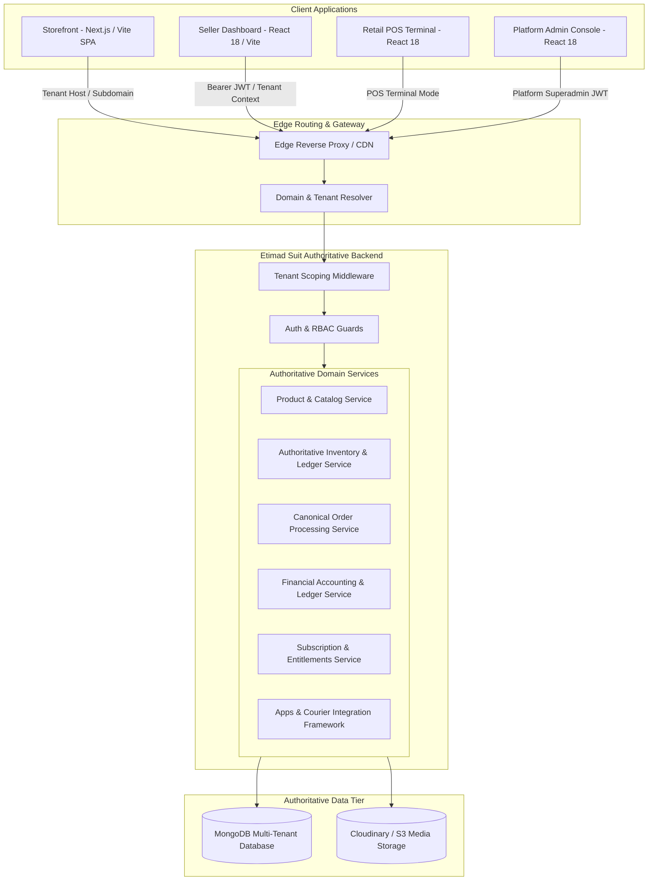
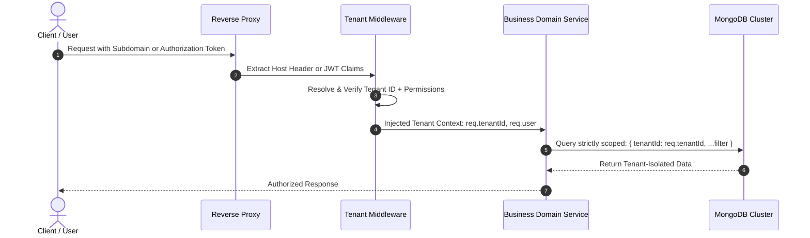
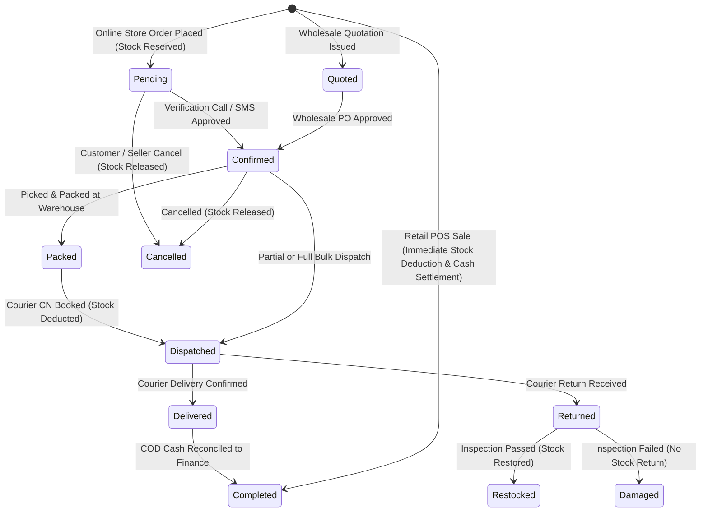
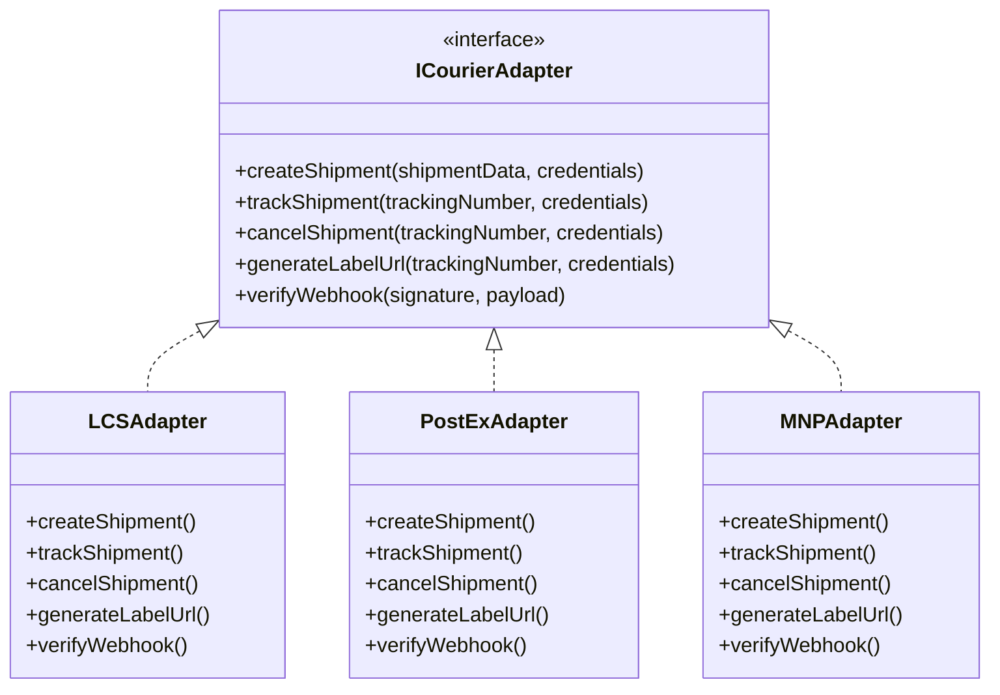

# Etimad Suit Architecture Specification

> **Status:** APPROVED ARCHITECTURAL BLUEPRINT  
> **Document Version:** 1.0.0  
> **Target System:** Etimad Suit Multi-Tenant SaaS Platform  
> **Author:** Lead Software Architect & Engineering Team  

---

## 1. Executive Summary & Vision

**Etimad Suit** transforms two standalone, single-tenant systems—[E-commerce Solution 2](https://github.com/chabdulrehman4u/Etimad-Mart-Ecommerce-Solution-2) and [Inventory Management System (IMS)](https://github.com/chabdulrehman4u/Etimad-Mart-IMS)—into an integrated, multi-tenant SaaS application for retail and wholesale merchants.

### Core Architectural Principle
> **ONE authoritative backend, ONE shared business data model, ONE canonical order system, and ONE authoritative inventory ledger.**

Online stores, retail Point-of-Sale (POS) counters, and wholesale distribution modules must never maintain separate competing stock or order records. Every sales channel executes against the same core business services.

---

## 2. High-Level System Architecture

Etimad Suit is architected as a **Modular Monolith** deployed with clear internal service boundaries.



---

## 3. Multi-Tenant Architecture & Isolation Engine

### 3.1 Tenancy Strategy
Etimad Suit utilizes a **Shared Database with Strict Tenant-Scoped Discriminator (`tenantId`)** combined with database-level compound indexing and backend middleware isolation.



### 3.2 Tenant Resolution Vectors
1. **Public Storefront Requests**:
   - Resolved by `Host` header matching an approved tenant subdomain (e.g., `brand.etimadsuit.com`) or a verified custom domain (e.g., `store.brand.com`).
   - If no custom domain matches, fallback to the platform flagship store or a 404 tenant-not-found handler.
2. **Seller Dashboard & POS Requests**:
   - Authenticated via secure HTTP-Only JWT cookies or Bearer tokens.
   - The token contains verified claims: `{ userId, tenantId, role, permissions }`.
   - **Never trust a client-submitted tenant ID.** The backend service layer always enforces `req.tenantId` derived from the validated token.
3. **Platform Administrator Requests**:
   - Superadmins possess a system-level role with cross-tenant viewing privileges only when explicitly entering an audited "Tenant Impersonation Mode".

### 3.3 Database Compound Unique Indexing
To prevent cross-tenant collisions while permitting duplicate codes across independent merchants:
- **SKU / Barcode**: `{ tenantId: 1, barcode: 1 }` (Sparse, Unique)
- **Product Slug**: `{ tenantId: 1, slug: 1 }` (Unique)
- **Order Numbers**: `{ tenantId: 1, orderNumber: 1 }` (Unique)
- **Customers**: `{ tenantId: 1, phone: 1 }` (Unique)

---

## 4. The Unified Backend: Module Decomposition

The backend modular monolith is organized into decoupled domain modules inside `backend/src/modules/`:

| Module | Core Responsibility | Key Entities |
| :--- | :--- | :--- |
| **`auth`** | Multi-tenant identity, password hashing, JWT issuing, RBAC validation | `User`, `Role`, `Session` |
| **`tenants`** | Tenant registration, branding, domain verification, store settings | `Tenant`, `DomainMapping`, `ThemeConfig` |
| **`subscriptions`** | SaaS pricing plans, feature gating, quotas, usage tracking, billing | `Plan`, `Subscription`, `UsageRecord` |
| **`products`** | Unified product catalog, variants, categories, brands, rich descriptions | `Product`, `Category`, `Brand`, `Variant` |
| **`inventory`** | Authoritative stock ledger, adjustments, warehouse transfers, alerts | `StockLedger`, `Warehouse`, `StockBalance` |
| **`orders`** | Canonical order state machine across online, POS, and wholesale | `Order`, `OrderItem`, `OrderHistory` |
| **`pos`** | Fast retail checkout, barcode scanner support, cash drawer reconciliation | `PosShift`, `CashReconciliation` |
| **`wholesale`** | B2B price lists, volume pricing tiers, customer khata, quotations | `WholesaleProfile`, `PriceTier`, `Quote` |
| **`purchases`** | Inbound supplier purchase orders, receiving, landed cost calculation | `PurchaseBatch`, `Supplier`, `Payable` |
| **`finance`** | Double-entry ledger, petty cash, bank accounts, balance sheet, valuation | `FinanceLedger`, `BankAccount`, `Expense` |
| **`shipping`** | Parcel booking, courier adapters (LCS, PostEx, M&P), tracking, returns | `Parcel`, `ShipmentBooking`, `ReturnRecord` |
| **`integrations`**| Apps framework, encrypted credential vault, webhook processor | `AppConnection`, `WebhookEvent` |
| **`reports`** | Real-time multi-dimensional analytics, sales, profit, stock valuation | `ReportSnapshot`, `SalesMetric` |

---

## 5. Canonical Order System

### 5.1 Unified Order Pipeline
Every sale originating from the **Online Storefront**, **Retail POS**, or **Wholesale Sales Desk** creates a record in the canonical `Order` collection with an explicit `channel` field:



### 5.2 Server-Authoritative Pricing Engine
Client requests never specify final monetary amounts. When an order is placed:
1. Product IDs and requested quantities are received.
2. The server loads the active unit price based on the channel (`retailPrice`, `wholesalePrice`, or `websitePrice`).
3. Tier discounts (volume pricing) and active coupons are validated server-side.
4. Taxes, delivery fees, and shipping surcharges are computed server-side.
5. `totalAmount = sum(lineTotals) + shippingFee + taxAmount - discountAmount`.
6. Price snapshots (`unitCostPriceSnapshot`, `unitSalePriceSnapshot`) are permanently written to `OrderItem`.

---

## 6. Authoritative Inventory Ledger

### 6.1 Concurrency & Overselling Prevention
To prevent race conditions where concurrent requests oversell the last unit, all stock-decrement operations must execute via **conditional atomic updates**:

```javascript
// High-concurrency atomic decrement with strict stock guard
const updatedProduct = await Product.findOneAndUpdate(
  {
    _id: productId,
    tenantId: tenantId,
    stock: { $gte: requestedQty } // Strict condition prevents negative stock
  },
  {
    $inc: { stock: -requestedQty }
  },
  { new: true }
);

if (!updatedProduct) {
  throw new InsufficientStockError(`Product ${productId} is out of stock`);
}
```

### 6.2 Immutable Stock Ledger
Every stock mutation creates an immutable entry in `StockLedger`:
- `tenantId`: Tenant identifier.
- `productId`: Targeted product ID.
- `warehouseId`: Warehouse location ID.
- `delta`: Positive (inflow) or negative (outflow).
- `previousStock`: Stock before operation.
- `newStock`: Resulting stock level.
- `type`: `PURCHASE_RECEIPT`, `SALE_DEDUCTION`, `RETURN_RESTOCK`, `ADJUSTMENT`, `TRANSFER`.
- `referenceModel` & `referenceId`: Linked `Order`, `PurchaseBatch`, or `Return`.
- `actorId`: User or system actor executing the change.

---

## 7. Apps & Provider Adapter Framework

To avoid hard-coding third-party logistics APIs into order controllers, Etimad Suit introduces an abstract **Provider Adapter Interface**:



### Security & Fault-Tolerance
1. **Encrypted Credentials**: Provider API keys, passwords, and tokens are encrypted at rest using AES-256-GCM using `DATA_ENCRYPTION_KEY`.
2. **Graceful Degrade**: If a courier API times out or fails, the order is safely saved in `Confirmed` state and flagged for asynchronous retry. A third-party outage will never block customer checkout.
3. **Idempotent Webhooks**: Courier delivery status callbacks are deduplicated using hash-based idempotency keys to prevent repeated ledger entries.

---

## 8. Technology Stack Summary

| Layer | Selected Technology | Operational Rationale |
| :--- | :--- | :--- |
| **Runtime** | Node.js (v20+ LTS), ES Modules | Standardizes across modern ESM tooling, high asynchronous I/O performance |
| **Backend Framework** | Express 4.x / 5.x | Battle-tested, lightweight, directly reuses audited controllers |
| **Database** | MongoDB 7+ / Mongoose 8.x | Document flexibility for e-commerce catalogs + native ACID transactions |
| **Frontend Applications** | React 18, Vite, Tailwind CSS | High build speed, shared component design system, sub-second HMR |
| **State Management** | TanStack React Query v5 | Efficient server-state synchronization, optimistic mutations, caching |
| **Validation** | Zod / Joi | Strict type-safe boundary validation on all ingress routes |
| **Testing** | Vitest / Jest, Supertest | Fast execution of unit and multi-tenant isolation test suites |

